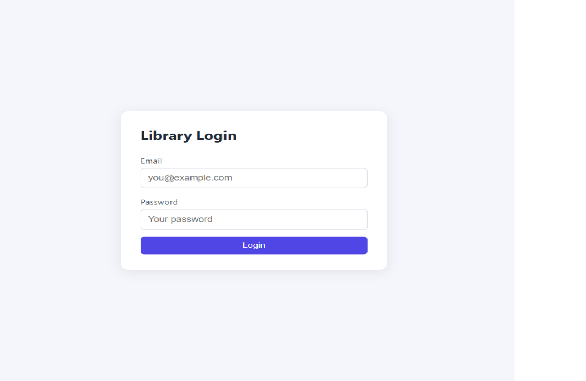
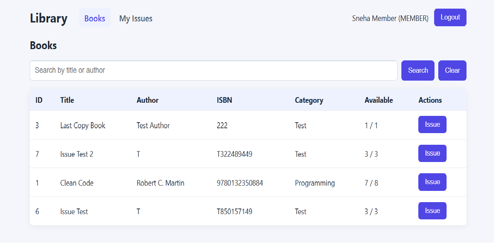
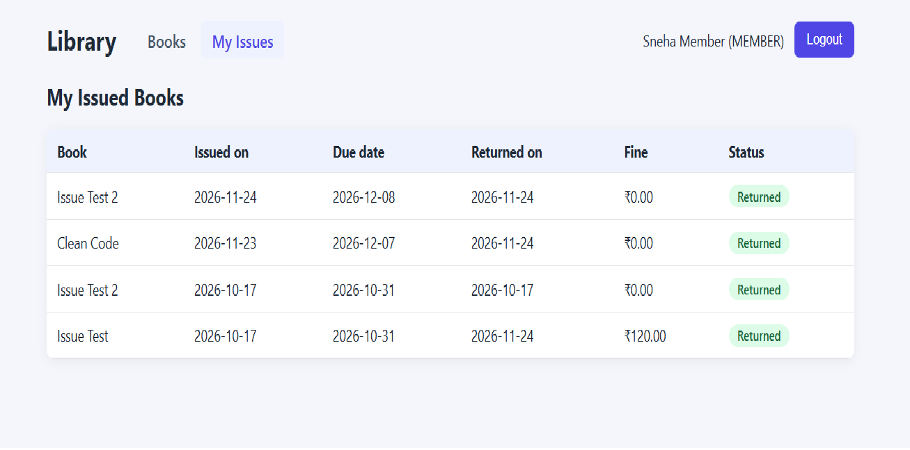
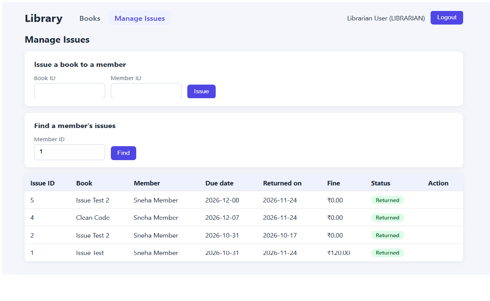

# Cloud-Based Library Management System

A full-stack library management system with **JWT authentication**, **role-based access** (Admin / Librarian / Member), book issue and return with **automatic fine calculation**, and **scheduled due-date email reminders**.

Built with Spring Boot, PostgreSQL and React.

## Screenshots

| Login | Books (Member) |
|---|---|
|  |  |

| My Issues (Member) | Manage Issues (Librarian) |
|---|---|
|  |  |

## Features

- **Authentication:** register and login, stateless JWT (Bearer token), passwords hashed with BCrypt
- **Role-based access:**
    - **Member:** browse and search books, issue a book for themselves, see their own issues
    - **Librarian:** add and edit books, issue books to members, process returns
    - **Admin:** everything a librarian can do, plus delete books and trigger reminders
- **Issue and return:** 14-day loan period, one active copy per member per book, available copies updated automatically
- **Fine calculation:** Rs. 5 per day after the due date, calculated on return
- **Email reminders:** a daily scheduled job (Spring `@Scheduled` cron) emails members whose books are due tomorrow or overdue
- **Validation and error handling:** Bean Validation and a global exception handler with consistent JSON errors (400, 401, 403, 409)
- **Frontend:** React app with protected routes, role-based navbar and buttons

## Tech Stack

| Layer | Technology |
|---|---|
| Backend | Java 17, Spring Boot 4, Spring Security, Spring Data JPA (Hibernate), Bean Validation, Lombok |
| Auth | JWT (jjwt), BCrypt |
| Database | PostgreSQL |
| Email | Spring Mail (Mailtrap sandbox for development) |
| Frontend | React (Vite), React Router, Axios |
| Tools | Maven, Postman, pgAdmin, Git and GitHub |

**Planned:** AWS S3 for book cover images, and deployment on AWS (EC2 and RDS).

## Project Structure

```
library-management/
├── src/main/java/com/sneha/librarymanagement/
│   ├── config/        # scheduling config
│   ├── controller/    # REST controllers
│   ├── dto/           # request and response objects
│   ├── entity/        # JPA entities and enums
│   ├── exception/     # global exception handling
│   ├── repository/    # Spring Data repositories
│   ├── security/      # JWT, filter, security config
│   └── service/       # business logic
├── frontend/          # React app (Vite)
└── docs/screenshots/
```

## Getting Started

### Prerequisites

Java 17, Maven, PostgreSQL, Node.js 20 or newer.

### 1. Database

Create an empty database in PostgreSQL:

```sql
CREATE DATABASE library_db;
```

Tables are created automatically by Hibernate on first run.

### 2. Backend configuration

Create `src/main/resources/application-local.properties`. This file is **gitignored**, so your secrets are never committed.

```properties
spring.datasource.url=jdbc:postgresql://localhost:5432/library_db
spring.datasource.username=YOUR_DB_USERNAME
spring.datasource.password=YOUR_DB_PASSWORD

# Base64 string of at least 48 random bytes
jwt.secret=YOUR_BASE64_SECRET

# Mailtrap sandbox (or any SMTP server)
spring.mail.host=sandbox.smtp.mailtrap.io
spring.mail.port=2525
spring.mail.username=YOUR_SMTP_USERNAME
spring.mail.password=YOUR_SMTP_PASSWORD
app.mail.from=library@example.com
```

Generate a JWT secret in PowerShell:

```powershell
$b = New-Object byte[] 48; [Security.Cryptography.RandomNumberGenerator]::Create().GetBytes($b); [Convert]::ToBase64String($b)
```

### 3. Run the backend

```bash
./mvnw spring-boot:run
```

The API runs on `http://localhost:8080`.

### 4. Run the frontend

```bash
cd frontend
npm install
npm run dev
```

The app runs on `http://localhost:5173`.

### 5. Create users

New registrations get the **MEMBER** role. To create a librarian or admin, register normally and then change the role in the database (for example with pgAdmin).

## API Overview

| Method | Endpoint | Access | Description |
|---|---|---|---|
| POST | `/api/auth/register` | Public | Register a new member |
| POST | `/api/auth/login` | Public | Login, returns a JWT |
| GET | `/api/books` | Any logged-in user | List books |
| GET | `/api/books/search?keyword=` | Any logged-in user | Search by title or author |
| POST | `/api/books` | Admin, Librarian | Add a book |
| PUT | `/api/books/{id}` | Admin, Librarian | Update a book |
| DELETE | `/api/books/{id}` | Admin | Delete a book |
| POST | `/api/issues` | Member (self), Admin, Librarian | Issue a book |
| PUT | `/api/issues/{id}/return` | Admin, Librarian | Return a book and calculate the fine |
| GET | `/api/issues/my` | Any logged-in user | Issues of the logged-in user |
| GET | `/api/issues/user/{userId}` | Own issues (Member), any user (staff) | Issues of a user |
| POST | `/api/admin/reminders/run` | Admin | Run the reminder job manually |

Send the token as `Authorization: Bearer <token>`.

## Security Notes

- Stateless authentication: the server keeps no session, every request carries a JWT.
- Access is enforced on the **backend** (URL rules plus business checks). The frontend only hides buttons for convenience.
- `401` means not logged in, `403` means logged in but not allowed.
- Secrets live in `application-local.properties`, which is not in the repository.

## Author

**Sneha Srivastav**
GitHub: [SnehaSrivastav04](https://github.com/SnehaSrivastav04)